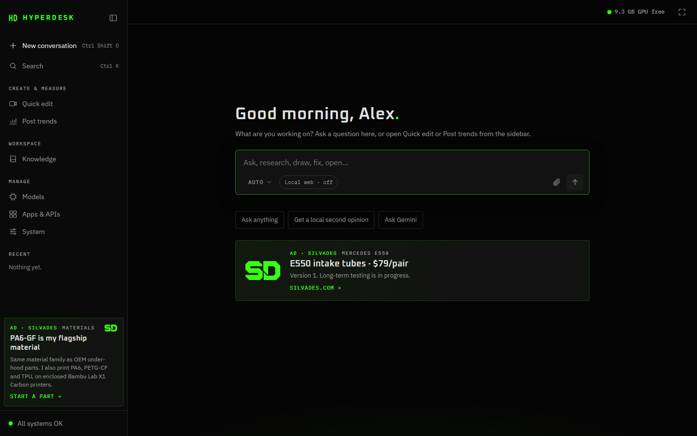

# HyperDesk OS

A free AI desktop for Windows that runs on your own PC. The model runs on your computer, so your conversations stay on it. Made by [SilvaDes](https://silvades.com).



**[Download the latest release](https://github.com/benjaminhoffman-bit/hyperdesk-os/releases/latest)** (the `HyperDesk-OS-<date>.zip` file under Assets).

## What you need

- Windows 10 or 11, 64-bit.
- About 15 GB of free disk space. The model alone is about 7 GB.
- An NVIDIA graphics card with 8 GB or more of video memory is recommended. It works without one, just slower.
- An internet connection for the install. After that, chat works offline.

## Install

1. Download `HyperDesk-OS-<date>.zip` from [Releases](https://github.com/benjaminhoffman-bit/hyperdesk-os/releases/latest).
2. Right-click the zip and pick **Extract All**.
3. Open the extracted **HyperDesk OS** folder and double-click **Install.cmd**.
4. Windows may warn that the publisher can't be verified. That is because the script isn't code-signed. Click **Run** (or **More info**, then **Run anyway**).
5. Type the name HyperDesk should call you, or press Enter to use your Windows name.

The installer needs no admin rights. It works for your Windows user only and shows each step as it goes. If Python or Ollama is missing, it installs it with winget and accepts its license terms for you (Python: PSF license, Ollama: MIT).

| Step | What happens |
|---|---|
| 1. Python 3.12 | Uses yours if it is there, otherwise installs it for your user with winget |
| 2. Disk space | Warns if you have under 15 GB free |
| 3. Copy | Puts HyperDesk in `%LOCALAPPDATA%\HyperDesk` |
| 4. Your name | Saves it in HyperDesk's settings |
| 5. Ollama | Uses yours if it is there, otherwise installs it for your user with winget, then starts it |
| 6. Graphics card | Shows your NVIDIA card and how much video memory it has |
| 7. The model | Downloads `gemma4:12b-it-qat` (about 7 GB, it can also read images) and names it `fast`, `code`, `daily` and `vision`. If you already have models with those names, they are kept as they are |
| 8. Shortcuts | HyperDesk, HyperDesk Home Base and HyperDesk Game Mode in the Start menu and on the desktop, HyperDesk Lights in the Start menu, plus Uninstall HyperDesk |
| 9. Start | Opens HyperDesk |

The first answer takes longer while the model loads into memory (often 30 to 60 seconds). After that it is quick.

## What it does

- **Chat** with the model on your PC. Pick Auto, This PC, or Local team (a draft, a review and a final answer, all on your PC).
- **Documents**: attach a PDF, Word, Excel or PowerPoint file and ask about it, or ask for a file ("make a pdf of this", "convert this to word"). New files go to `%LOCALAPPDATA%\HyperDesk\workspace\files` and never overwrite your originals.
- **Knowledge**: save facts and notes HyperDesk should know, and wrap up a conversation into a handoff for next time. Nothing is saved there unless you click Save or start a message with "remember:".
- **Local web** (off until you switch it on): the local model can do one Bing search and read up to two public pages to answer.
- **Home Base**: a small window with health checks, the GPU and loaded models, Unload models and Stop all AI.
- **Post trends** (the Analytics page): export your posts as a CSV from TikTok Studio, YouTube Studio (unzip it and pick `Table data.csv`) or Meta Business Suite, and pick the file. It shows which hashtags, days and times did better than your usual, and your top posts. The file never leaves your PC, and no account sign-in is needed.
- **Game Mode** (Start menu): before a game, it lists your open apps, ticks the ones that can go, and asks them to close the way clicking X does, so each one can ask you to save first. It then stops the local AI so the game gets the graphics card. It never closes Windows itself, anti-cheat, Discord, music apps, game launchers, screen readers, the common driver helpers, password managers, or sync and VPN apps: those show under Keeping instead. Untick anything else you want to keep.

Optional, if you want them:

- **Claude Code**: if you have a Claude plan, install Claude Code and sign in. You can then pick Claude for bigger questions; Auto never sends anything to it by itself.
- **A free cloud tier**: get a free Groq API key at [console.groq.com](https://console.groq.com) and save it in **Apps & APIs**, Free cloud. For another OpenAI-compatible provider, change `url` and `model` under `[free]` in `%LOCALAPPDATA%\HyperDesk\AgentOS\config.toml`.
- **Gemini**: save your own Gemini API key and a model ID from [Google AI Studio](https://aistudio.google.com/) in **Apps & APIs**.
- **Quick edit** (the Video page): pick a recording and it cuts out the frozen, silent pauses. You can also type edits, one per line: `trim start 5`, `cut 2:10-2:40`, `speed 4:00-6:30 2`, `transition fade`. It makes a landscape video, a 1080x1920 vertical one, or both. There's no AI in it, and it runs on your PC. It needs FFmpeg: run `winget install Gyan.FFmpeg`, then reopen HyperDesk.
- **Lights** (Start menu): one color and brightness for your PC's RGB lights, through [OpenRGB](https://openrgb.org). Install OpenRGB yourself and open its SDK Server tab. Keep the host at `127.0.0.1` and the port at 6742, click Start Server, then click Rescan in Lights.
- **Voice input**: the mic button appears when Open WebUI (with its faster-whisper) is installed through uv. Without it, it stays hidden.

## The ads

This free build shows small ads for SilvaDes, my business: one card in the sidebar and one on the empty chat page. They are built into the app. Nothing is downloaded or stored for them. A click opens silvades.com, or SilvaDes on TikTok, in your browser. The silvades.com links tell the site they came from HyperDesk and which ad, nothing about you.

## Privacy

- HyperDesk listens only on your own PC (`127.0.0.1`), and its page needs a key that changes every time it starts.
- Your conversations, Knowledge and settings stay in `%LOCALAPPDATA%\HyperDesk`.
- Nothing goes to the cloud unless you set it up and pick it: Claude Code, the free cloud tier or Gemini. Files you attach and your Knowledge are never sent to the free cloud tier or to Gemini.
- Local web, when you switch it on, sends a search built from your current question to Bing and opens up to two public pages from your PC. Attachments, Knowledge and earlier messages are never part of it.
- Quick edit, Post trends, Game Mode and Lights never use the internet. Lights talks only to OpenRGB on `127.0.0.1`.

## Update

Download the newer zip and run its **Install.cmd**. It keeps your conversations, your Knowledge and your name. It replaces `config.toml` with the new one and saves your old one next to it as `config.toml.bak`, so you can copy back any changes you made.

## Uninstall

Start menu, **Uninstall HyperDesk** (or run `Uninstall.cmd` in `%LOCALAPPDATA%\HyperDesk`). It removes HyperDesk and everything in that folder, including your conversations, Knowledge and the files and videos it made in `workspace\files` and `workspace\videos` (move any you want to keep first). Ollama, Python and the model stay, because other apps may use them. The uninstaller prints the commands to remove those too, if you installed them only for HyperDesk.

## Troubleshooting

| Problem | What to do |
|---|---|
| Install.cmd says to unzip first | You opened it inside the zip. Right-click the zip, Extract All, then run Install.cmd from the extracted folder. |
| "winget" is missing, or Python or Ollama will not install | Install [Python 3.12](https://www.python.org/downloads/windows/) and [Ollama](https://ollama.com/download) yourself, then run Install.cmd again. On Windows 10, App Installer from the Microsoft Store brings winget. |
| The model download fails | If it says the model needs a newer Ollama, update Ollama from [ollama.com](https://ollama.com/download) (or `winget upgrade -e --id Ollama.Ollama`). Otherwise check the internet connection. Then run Install.cmd again. It picks up where it stopped. |
| "Ollama is not answering" | Open Ollama from the Start menu, then send your message again. |
| Answers are slow | Close games and other apps that use the graphics card. Without an NVIDIA card with 8 GB or more, answers are slower. |
| The uninstaller says the folder is not an install | Use Start menu, Uninstall HyperDesk. The copy in the unzipped download folder is the installer, not the install. |

## What's in this repo

The release zip's files (the main ones are shown), plus `README.md`, `.gitattributes` and `docs/` for this page:

```
Install.cmd            double-click to install
README.txt             these instructions, short
LICENSE.txt            the license
app/
  setup.ps1            the installer and uninstaller
  Uninstall.cmd        runs setup.ps1 -Uninstall
  Stop AI.bat          ends Ollama and HyperDesk
  bin/unload-ai.cmd    unloads the models from memory
  AgentOS/             the app (Python 3.12 and its standard library; voice uses Open WebUI's faster-whisper)
    hyperdesk.pyw      HyperDesk's local server; opens the app window
    hyperdesk.html     the app's page
    homebase.pyw       Home Base
    gamemode.pyw       Game Mode
    lights.pyw         Lights
    quick_edit.py      Quick edit (the Video page)
    post_trends.py     Post trends (the Analytics page)
    agent_os.py        routing, the local models, health checks
    config.toml        the settings
    assets/            icons, fonts, silvades.js (the ads)
```

## Made with

- [Ollama](https://ollama.com) runs the model. The installer installs it from its publisher.
- Google's Gemma 4 model, from the [Ollama library](https://ollama.com/library/gemma4). Its own terms apply.
- [Python 3.12](https://www.python.org).
- The fonts Oxanium and IBM Plex, under the SIL Open Font License 1.1 (the license texts are in `app/AgentOS/assets/fonts`).

## License

Free to download, install and use. Please don't sell it or share changed copies. The details are in [LICENSE.txt](LICENSE.txt).

## Contact

[silvades.com](https://silvades.com) · benjaminhoffman@silvades.com · @silvadesllc on TikTok and Instagram
